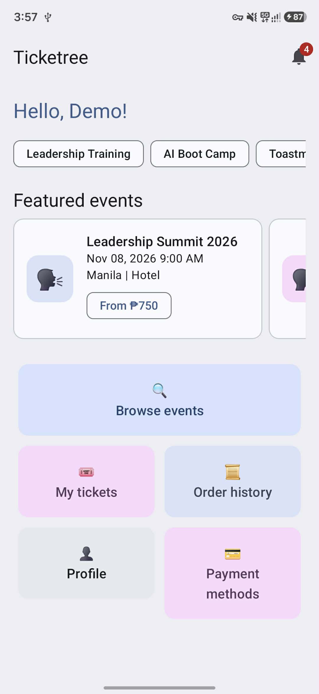
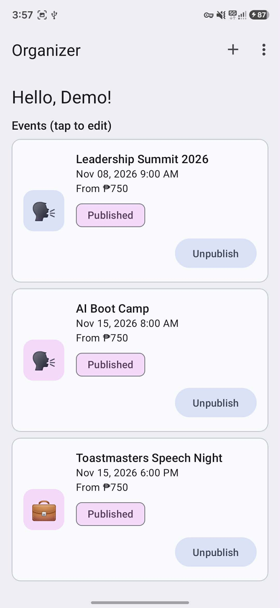
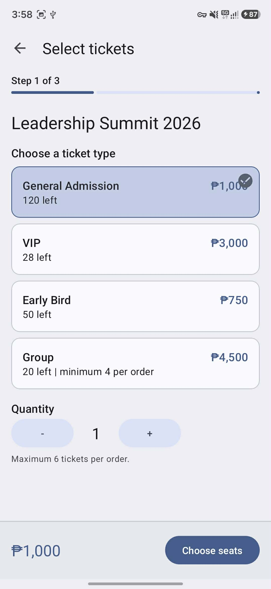
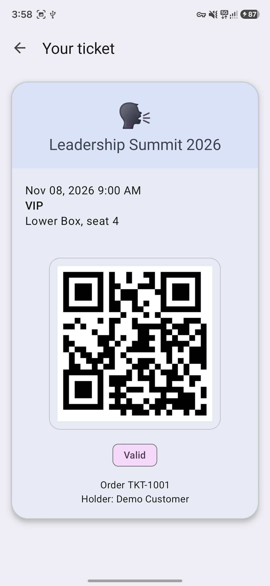
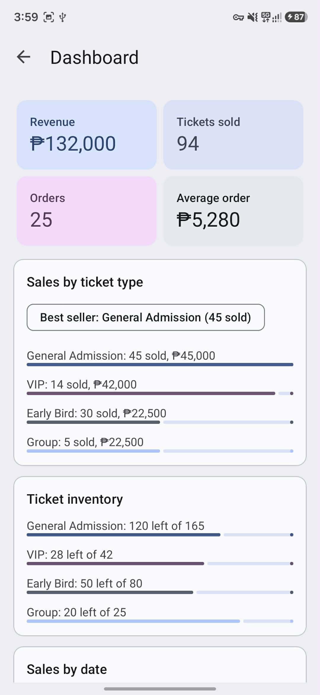

# Ticketree

An Android event ticketing app that takes a customer from discovering an event to holding a QR ticket in a digital wallet, with a matching side for event organizers. Built for a hackathon as a fully simulated demo: no backend, no payment gateway and no real emails.

**Core flow:** Discover Event → Select Ticket → Pick Seats → Checkout → Pay → Receive QR Ticket

## About the hackathon

| | |
|---|---|
| Event | Tagisan Ng Talino Local 2026 - 2027 Code Fest |
| Level | Local |
| Placement | _Champion_ |
| Team Name | ERRAnds |
| Team Members | Vrixzandro Eliponga, Michael Tagle, Christine Jane Lapuz |
| Challenge | Develop an Event Ticketing Application with customer and organizer modules |

## Features

**Customer**
- Sign up, log in and log out, profile editing and a simulated password reset
- Payment methods: e-wallets (GCash, Maya, ShopeePay, GrabPay) and credit/debit cards, with a default method
- Home with featured events and category chips, plus an event list with search and date, location and category filters
- Event details with images, speaker lineup, ticket types and availability, organizer info, terms and conditions, and age restriction
- Ticket selection (General Admission, VIP, Early Bird, Group), seat selection across 3 boxes of 20 seats, and a 2-minute seat hold
- Checkout with order summary, billing info, payment method choice, simulated payment, confirmation and a receipt
- Digital ticket wallet with a QR ticket for each seat
- Simulated notifications (booking, payment, ticket delivery and event reminder)
- Order history and payment receipts

**Organizer**
- Organizer registration and profile
- Create, edit and publish or unpublish events
- Venue management and ticket pricing and stock management
- Dashboard with revenue, tickets sold, orders, sales by ticket type, sales by date and ticket inventory

## Tech specs

| | |
|---|---|
| Language | Java 11 |
| UI | XML layouts, Material Design 3 (Material Components 1.14), view binding |
| Min / target SDK | 24 (Android 7.0) / 36 |
| Build | Android Gradle Plugin 9.2.1, Gradle 9.4.1 |
| Storage | SQLite for user accounts, in-memory state for everything else |
| Theme | Material Theme Builder palette with light and dark mode |
| Navigation | One Activity per screen (20+ screens), no fragments |
| Libraries | AndroidX AppCompat, Material Components and ConstraintLayout only |

## Requirements

- Android Studio (a recent version that supports AGP 9.x) and JDK 11 or newer
- An Android emulator or device running Android 7.0 (API 24) or higher

## Getting started

```bash
git clone https://github.com/<your-username>/Ticketree.git
cd Ticketree
./gradlew assembleDebug
```

Then open the project in Android Studio and press **Run** on an emulator. The debug APK is created at `app/build/outputs/apk/debug/`.

## Demo accounts

| Role | Email | Password |
|---|---|---|
| Customer | `customer@demo.com` | `demo1234` |
| Organizer | `organizer@demo.com` | `demo1234` |

Logging in as the demo customer loads a sample purchase (one order, receipt, two VIP tickets and four notifications) so the wallet, history and notifications are not empty. You can also sign up for a new customer or organizer account from the Sign up screen.

## What is simulated

- Payments always succeed after a short processing screen.
- Emails, password reset links and notifications are in-app only (toasts, snackbars and a notification list).
- The QR code and the seat map are static images, not generated.
- Events, tickets, orders and notifications are kept in memory and reset when the app restarts. Accounts are saved in SQLite.

## Project structure

```
app/src/main/java/com/mowtiie/ticketree/
├── activities/   one Activity per screen
├── adapters/     GenericAdapter, the single shared RecyclerView adapter
└── data/         Data (all app state and seed data) and DbHelper (SQLite)
```

## Screens

Login, Sign up, Reset password, Home, Event list, Event detail, Ticket select, Seat select, Checkout, Confirmation, Ticket wallet, Ticket view, History, Notifications, Profile, Payment methods, Organizer home, Event form, Ticket pricing, Venue management, Organizer dashboard.

## Screenshots

<div align="center">
	<div>
         
         
         
         
         
         
	</div>
</div>

## Verification

APK releases on GitHub are signed using my key. They can
be verified using
[apksigner](https://developer.android.com/studio/command-line/apksigner.html#options-verify):

```
apksigner verify --print-certs --verbose ticketree.apk
```

The output should look like:

```
Verifies
Verified using v1 scheme (JAR signing): false
Verified using v2 scheme (APK Signature Scheme v2): true
Verified using v3 scheme (APK Signature Scheme v3): false
Verified using v3.1 scheme (APK Signature Scheme v3.1): false
Verified using v3.2 scheme (APK Signature Scheme v3.2): false
Verified using v4 scheme (APK Signature Scheme v4): false
```

The certificate fingerprints should correspond to the ones listed below:

```
Owner: CN=Mowtiie
Issuer: CN=Mowtiie
Serial number: 8a256fdcdde50069
Valid from: Wed Jun 10 22:57:23 PST 2026 until: Sun Oct 26 22:57:23 PST 2053
Certificate fingerprints:
         SHA1: 56:4E:2C:DB:E4:06:C9:EC:15:E6:BC:D9:0A:88:38:72:8B:FB:13:20
         SHA256: 8B:67:51:F3:C3:31:85:63:5F:98:95:30:B6:C0:73:A1:39:7B:3D:41:2B:EF:AE:69:06:A2:EB:58:45:D2:DE:63
```

**Warning:** Only install Ticketree APKs signed with the key above. Verifying the signature confirms you're running a genuine, unmodified build.

### PGP Signing

As an additional layer on top of the Android signature above, each release is also signed with my PGP key. While `apksigner` confirms the APK itself is intact, a PGP signature confirms that *I* am the one who published this specific file to GitHub — an independent check that doesn't rely on GitHub's account security alone.

**Public key fingerprint:**
```
9EA2 8F46 7802 5092 7643 1B69 42B5 FA42 AA63 90E1
```

Download and import the key from my website, or directly from this repo:

```
curl -O https://mowtiie.cc/PGP_PUBLIC_KEY.asc
gpg --import PGP_PUBLIC_KEY.asc
```

After importing, confirm the fingerprint printed by GPG matches the one listed above — that match is what actually establishes trust, not the import step itself. Fetching the key over HTTPS from a domain you already trust is arguably a stronger anchor than a keyserver, since keyservers accept uploads from anyone and don't vouch for identity.

Each release includes a detached `.asc` signature alongside the APK. Verify a downloaded release with:

```
gpg --verify ticketree.apk.asc ticketree.apk
```

A valid signature looks like:

```
Good signature from "Mowtiie <mowtiie.dev@gmail.com>"
```

**Note:** PGP signing is a supplementary trust measure, not a substitute for the `apksigner` check above — verify both if you want the highest confidence that a release is genuine and unmodified.
